# Olist Intelligence

Ứng dụng phân tích dữ liệu thương mại và trợ lý bán hàng tích hợp Odoo. Dự án chạy local bằng Python/FastAPI, HTML/CSS/JavaScript, SQLite và Odoo Community.

Bài toán chính là giúp người bán tra số liệu, tìm tài liệu, kiểm tra báo giá và chuẩn bị công việc chăm sóc khách. Vì dùng model nhỏ và API giới hạn, chương trình giữ phần tính toán, dữ liệu nguồn và quyền ghi ở backend; model chỉ xử lý phần ngôn ngữ hoặc lựa chọn trong phạm vi cho phép.

**Đây là bản demo kỹ thuật**, dùng Olist công khai và Odoo DEMO. Chưa triển khai cho doanh nghiệp, chưa fine-tune LLM và chưa chứng minh tăng doanh thu.

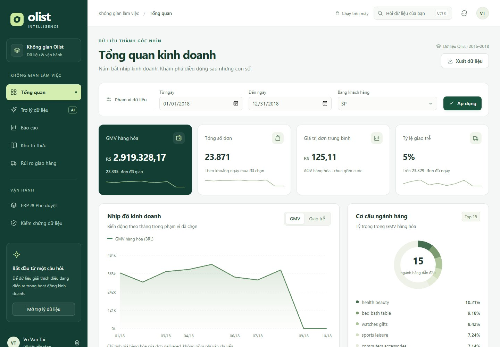

[Ảnh chứng minh chức năng](#6-cách-dùng-và-demo-từng-chức-năng) · [Bằng chứng demo](reports/demo_evidence.json) · [Báo cáo đo AI](reports/ai_delivery_20261124.json)

## Mục lục

- [1. Chức năng](#1-chức-năng)
- [2. Kiến trúc](#2-kiến-trúc)
- [3. Cài và chạy](#3-cài-và-chạy)
- [4. Cấu hình model](#4-cấu-hình-model)
- [5. Cài Odoo](#5-cài-odoo)
- [6. Cách dùng và demo từng chức năng](#6-cách-dùng-và-demo-từng-chức-năng)
- [7. RAG hoạt động thế nào](#7-rag-hoạt-động-thế-nào)
- [8. Tối ưu model nhỏ và API giới hạn](#8-tối-ưu-model-nhỏ-và-api-giới-hạn)
- [9. Vấn đề đã gặp và cách giải quyết](#9-vấn-đề-đã-gặp-và-cách-giải-quyết)
- [10. Phạm vi dữ liệu và bảo mật](#10-phạm-vi-dữ-liệu-và-bảo-mật)
- [11. Kết quả đo](#11-kết-quả-đo)
- [12. Kịch bản trình diễn và tái lập bằng chứng](#12-kịch-bản-trình-diễn-và-tái-lập-bằng-chứng)
- [13. Kiểm thử, cập nhật và xử lý lỗi](#13-kiểm-thử-cập-nhật-và-xử-lý-lỗi)
- [14. Mã nguồn, dữ liệu và giấy phép](#14-mã-nguồn-dữ-liệu-và-giấy-phép)

## 1. Chức năng

| Phần | Người dùng thao tác | Cách xử lý |
|---|---|---|
| Tổng quan | Lọc ngày/bang, xem KPI, biểu đồ/bảng, tải CSV | SQL có tham số trên dữ liệu Olist |
| Trợ lý thường | Hỏi KPI hoặc định nghĩa | Chọn một công cụ; số lấy từ công cụ |
| Đội agent | Hỏi kết hợp BI, tài liệu hoặc Odoo | Điều phối agent, thu bằng chứng, kiểm tra và tổng hợp |
| Báo cáo | Chỉnh nhận xét, chọn biểu đồ, lưu nháp, tải PDF/Excel | Snapshot từ BI, có bảng và biểu đồ |
| Kho tri thức | Tra quy trình/định nghĩa và mở nguồn | Hybrid retrieval, model local chọn trích đoạn |
| ML giao trễ | Chọn đơn lịch sử, đọc điểm/ngưỡng và holdout | Model scikit-learn, có cảnh báo giới hạn |
| ERP trên web | Tra khách/sản phẩm, đối soát và duyệt báo giá | Odoo tính giá/thuế; ghi bản nháp sau duyệt |
| PDF báo giá | Tải PDF của báo giá DEMO đang có | Đọc chứng từ hiện tại, không đánh dấu gửi |
| Chăm sóc trong Odoo | Xem ưu tiên, kiểm tra đề xuất, duyệt tạo việc | Cờ quy tắc, AI chọn góc trao đổi, nội dung local |
| Rủi ro báo giá | Xem cờ, ghi nhận, so trước/sau, xuất báo cáo | Snapshot và lịch sử xử lý giữ tại Odoo |
| Gợi ý theo ngân sách | Nhập nhu cầu/số lượng/ngân sách, chọn phương án | Odoo lọc; AI xếp hạng tùy chọn |
| Kiểm chứng/đo thao tác | Xem đối soát, checksum, nhật ký, tự chấm lượt đo | Giữ nguồn, thời gian và cả lượt thất bại |

AI chăm sóc, AI diễn giải rủi ro và AI xếp hạng là các luồng riêng. Kết quả tốt của một luồng không được dùng để khẳng định các luồng còn lại cũng tốt.

## 2. Kiến trúc

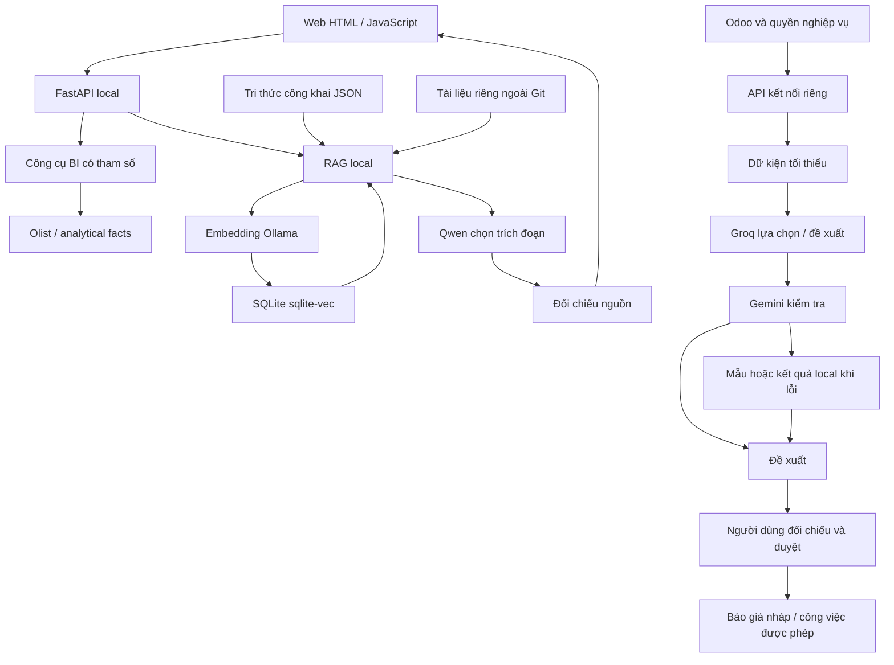

LLM xử lý ngôn ngữ, chọn công cụ/lựa chọn hoặc kiểm tra. ML giao trễ là model riêng trên dữ liệu lịch sử, không phải LLM.

Đội agent dùng Groq cho điều phối, BI và ERP; Gemini cho tri thức, kiểm tra và tổng hợp. Qwen tóm tắt local là tùy chọn, chỉ chạy khi bật và lịch sử đủ dài. Tài liệu riêng chỉ đi qua RAG local; công cụ tài liệu của agent cloud chỉ đọc tri thức công khai đóng gói.

## 3. Cài và chạy

### 3.1. Chuẩn bị

- Python **3.12 64-bit** là môi trường đã kiểm tra; launcher cũng chấp nhận 3.13.
- Docker Desktop nếu dùng Odoo.
- Ollama nếu dùng embedding/Qwen local.
- Không cần Node để chạy app; Node chỉ dành cho kiểm tra JavaScript/preview phát triển.

Mở PowerShell:

```powershell
git clone https://github.com/taiiswibu/Olist_Intelligence.git
cd Olist_Intelligence
.\SETUP_WINDOWS.bat
```

SETUP tạo `.venv`, cài thư viện, tạo `.env`, tải và chuyển đổi chín CSV Olist. Database phân tích đã có được giữ lại. Nếu tải lỗi, ứng dụng không thay bằng số liệu giả.

Nếu Kaggle không tải được, tải bộ [Brazilian E-Commerce Public Dataset by Olist](https://www.kaggle.com/datasets/olistbr/brazilian-ecommerce), giải nén chín CSV trực tiếp vào `data/raw/` rồi chạy:

```powershell
.\.venv\Scripts\python.exe manage.py setup
```

### 3.2. Mở web

```powershell
.\START_WINDOWS.bat
```

Trình duyệt mở **http://127.0.0.1:8000/**. Giữ launcher mở; Ctrl+C để dừng. Có thể chạy thẳng bằng `.\.venv\Scripts\python.exe run.py`.

Launcher ưu tiên Python của dự án, xuất UTF-8 và kiểm tra cổng. Link tự mở có ticket dùng một lần, được xóa khỏi thanh địa chỉ sau khi xác thực. Mở thủ công thì dùng `APP_TOKEN` trong `.env` ở cửa sổ kết nối; không đưa token vào chat, ảnh hoặc Git.

### 3.3. Cài thêm phần agent

```powershell
.\.venv\Scripts\python.exe -m pip install --timeout 180 --retries 10 --progress-bar off -r requirements.txt
.\.venv\Scripts\python.exe -m pip install -r requirements-agent.txt
```

Dòng thứ hai dành cho Đội agent/Agent Lab và các luồng AI dùng LangChain. Chỉ chạy lệnh tiếp theo khi lệnh trước thành công. Sửa `.env` xong cần khởi động lại backend. Không chạy nhiều instance trên cùng database.

## 4. Cấu hình model

Các tên dưới đây là cấu hình đã dùng trong lượt đo ngày 24/11/2026, **không phải cam kết tài khoản nào cũng được gọi miễn phí**.

| Thành phần | Model đã dùng | Vai trò |
|---|---|---|
| Groq | `openai/gpt-oss-20b` | Điều phối, công cụ, lựa chọn chăm sóc |
| Gemini | `gemini-3.5-flash-lite` | Tri thức, kiểm tra, tổng hợp |
| Ollama | `qwen3:4b-instruct-2507-q4_K_M` | Trích đoạn local, tóm tắt tùy chọn |
| Ollama embedding | `embeddinggemma:300m` | Vector tài liệu và câu hỏi |

### 4.1. BI và RAG local, không gọi cloud

```powershell
ollama pull embeddinggemma:300m
ollama pull qwen3:4b-instruct-2507-q4_K_M
ollama list
```

Cấu hình `.env`:

```dotenv
LLM_PROVIDERS=
FOLLOWUP_AI_MODE=rules_only
OLLAMA_BASE_URL=http://127.0.0.1:11434
OLLAMA_MODEL=qwen3:4b-instruct-2507-q4_K_M
RAG_ANSWER_MODEL=qwen3:4b-instruct-2507-q4_K_M
EMBED_MODEL=embeddinggemma:300m
RAG_MODE=hybrid
```

Lập index rồi khởi động lại backend:

```powershell
.\.venv\Scripts\python.exe manage.py embed
```

RAG local gọi Ollama riêng nên không cần thêm Ollama vào `LLM_PROVIDERS` để tra tài liệu. Chọn **Trợ lý thường** khi không cấu hình Đội agent cloud. Nếu model local lỗi hoặc máy thiếu tài nguyên, đọc nguồn và thông báo dự phòng.

### 4.2. Bật Groq/Gemini

```dotenv
LLM_PROVIDERS=groq,gemini
GROQ_API_KEY=your_key
GROQ_MODEL=exact_model_id_available_to_your_account
GEMINI_API_KEY=your_key
GEMINI_MODEL=exact_model_id_available_to_your_account
FOLLOWUP_AI_MODE=cloud_minimized
FOLLOWUP_MAX_ATTEMPTS=2
FOLLOWUP_REQUEST_INTERVAL_SECONDS=12
```

Giữ khóa thật trong `.env`. Kiểm tra model tài khoản được gọi:

```powershell
.\.venv\Scripts\python.exe manage.py models --provider groq
.\.venv\Scripts\python.exe manage.py models --provider gemini
```

Có adapter OpenRouter, NVIDIA, AMD và Ollama; chỉ provider đủ URL/model/key mới được gọi. Phần mềm không biết số dư, không tự đổi tài khoản/key để né quota.

Quota phụ thuộc model/tài khoản. Gemini có giới hạn theo request/token và project; đổi key trong cùng project không phải cách tăng quota. Xem [Groq rate limits](https://console.groq.com/docs/rate-limits) và [Gemini rate limits](https://ai.google.dev/gemini-api/docs/rate-limits). Không có RPM cố định trong README áp dụng cho mọi tài khoản.

## 5. Cài Odoo

### 5.1. Kết nối server-to-server

Sau khi Docker Desktop chạy:

```powershell
.\.venv\Scripts\python.exe scripts/configure_odoo_ai.py
docker compose up -d odoo
docker compose ps
```

Script tạo bridge token trong `.env` mà không in khóa. Container đã chạy trước khi tạo/đổi khóa thì cập nhật môi trường:

```powershell
docker compose up -d --force-recreate odoo
```

Lệnh tạo lại container dịch vụ, không xóa volume. **Không dùng `docker compose down -v` với database muốn giữ.**

### 5.2. Database và addon

Mở **http://127.0.0.1:8069/**:

1. Tạo database riêng, ví dụ `olist_demo`; tự đặt tài khoản/mật khẩu.
2. Cài **Sales**.
3. Bật chế độ nhà phát triển, cập nhật Apps list nếu cần.
4. Cài **AI hỗ trợ bán hàng**, tên kỹ thuật `olist_sales_ai`.
5. Cấp quyền nhân viên bán hàng hoặc quản lý nhóm phù hợp.

Addon mount từ `odoo_addons/`. Bản đã kiểm tra là Odoo Community 19, addon `19.0.1.6.1`.

```dotenv
ODOO_URL=http://127.0.0.1:8069
ODOO_DB=olist_demo
ODOO_LOGIN=your_odoo_login
ODOO_PASSWORD=your_password_or_api_key
```

`ODOO_PASSWORD` là mật khẩu/API key người dùng Odoo, không phải mật khẩu PostgreSQL hoặc master password của database manager. Bridge không dùng `APP_TOKEN` của web. Trong Docker Desktop, Odoo gọi backend qua `host.docker.internal:8000`.

### 5.3. Kiểm tra và nhập DEMO

```powershell
.\.venv\Scripts\python.exe manage.py odoo-check
.\.venv\Scripts\python.exe manage.py odoo-seed --limit 10
```

`odoo-check` chỉ đọc. `odoo-seed` tạo khách, sản phẩm, báo giá DEMO từ dữ liệu lịch sử; chỉ chạy trên database DEMO đã chọn. Không xác nhận đơn, xuất kho hoặc lập hóa đơn. `origin` giữ nguồn để tránh nhập lặp tuần tự.

Olist không có tên hàng thật, thông số hoặc tồn kho. Tên sản phẩm DEMO dựng từ nhóm hàng; giá lịch sử, giá thẻ USD và giá báo giá BRL có ý nghĩa khác nhau.


## 6. Cách dùng và demo từng chức năng

### 6.1. Tổng quan và CSV

Chọn ngày mua, bang khách hàng rồi **Áp dụng**. Xem GMV/giao trễ theo tháng, ngành hàng, bảng seller/bang và tìm trong bảng. **Xuất CSV** lấy bảng đang xem trong phạm vi hiện tại.

- Mặc định 01/01/2017–31/08/2018, không phải toàn bộ snapshot.
- GMV cộng giá hàng hóa của đơn delivered, chưa gồm cước, không phải doanh thu ròng.
- AOV chia cho số đơn delivered, không chia cho số item/payment.
- Giao trong bất kỳ giờ nào của đúng ngày hẹn vẫn đúng hạn.
- Seller: tối đa 20 dòng, tối thiểu 20 đơn, xếp theo số đơn trễ. Không coi seller là nguyên nhân gây trễ chỉ từ bảng này.

### 6.2. Trợ lý thường và Đội agent

Trong **Trợ lý dữ liệu**, chọn chế độ:

- **Trợ lý thường:** một công cụ, phù hợp câu hỏi ngắn, ít request hơn.
- **Đội agent:** ghép công cụ/tài liệu và kiểm tra, dùng nhiều request hơn. Đây là lựa chọn mặc định khi mở giao diện hiện tại.

Thử các câu:

```text
Tổng quan KPI tháng 2/2018 bang SP
Tính GMV hàng hóa và AOV tháng 2/2018 bang SP, giải thích công thức AOV theo tài liệu.
GMV hàng hóa có gồm phí vận chuyển không?
```

Mở bằng chứng để xem công cụ, SQL, phạm vi hoặc mã tài liệu. Dữ liệu lịch sử không trả được doanh thu “hôm nay”. So sánh nhiều kỳ tùy ý chưa được hỗ trợ.

Đội agent giới hạn **12 lượt model, 12 công cụ, 120 giây, 2 agent đồng thời, 1 vòng bổ sung bằng chứng**. Thiếu bằng chứng/API lỗi được giữ trong trạng thái kết quả. Mất kết nối thì **Lấy lại lượt vừa gửi**, tránh tạo lượt mới không cần thiết.

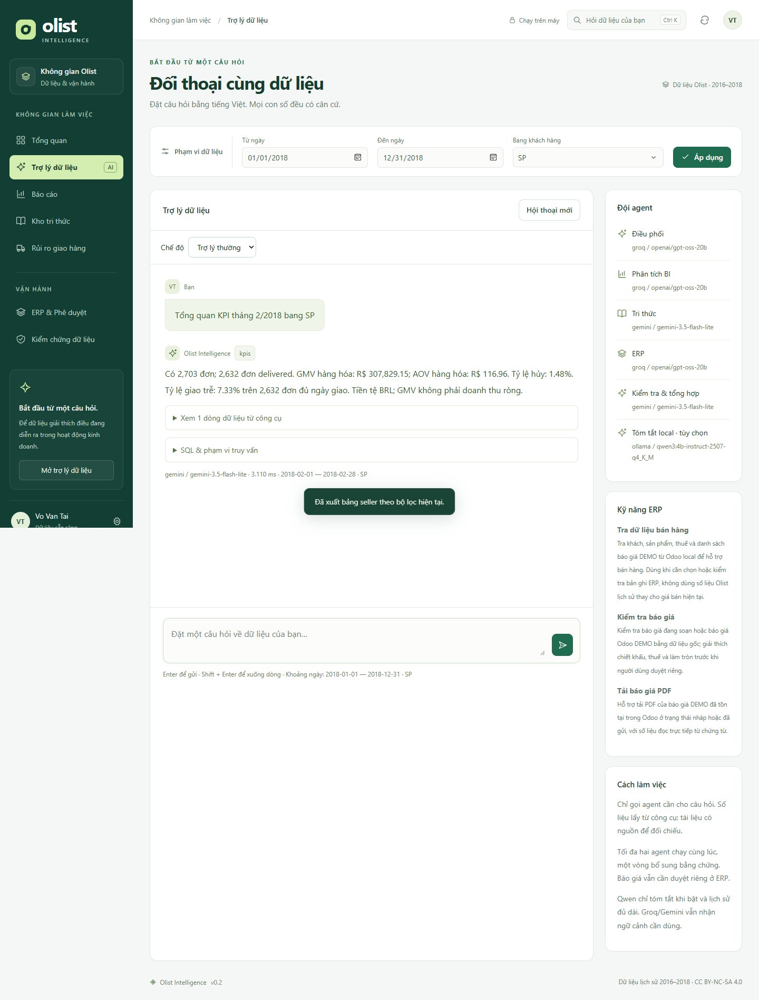

<details>
<summary>Xem Đội agent kết hợp BI và tài liệu</summary>

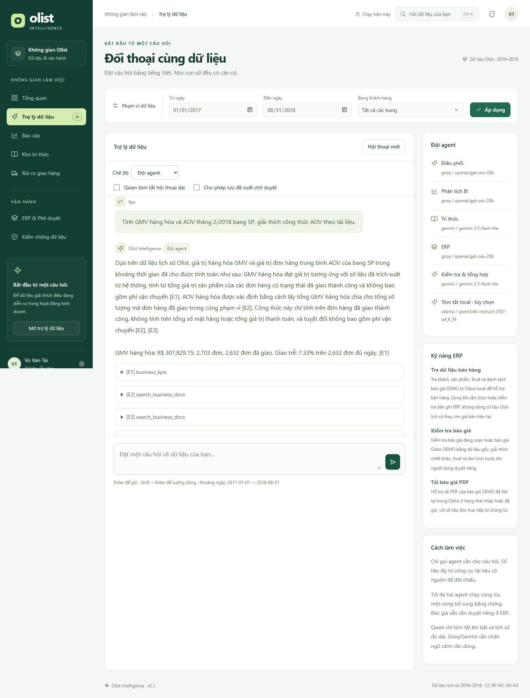

</details>

### 6.3. Báo cáo, biểu đồ và file tải về

Mở **Báo cáo → Tạo báo cáo**:

1. Chọn phạm vi, đổi tiêu đề và nhận xét.
2. Chọn đường/cột, nguồn và chỉ tiêu; thêm/bỏ/đổi thứ tự tối đa sáu biểu đồ.
3. **Lưu bản nháp** để mở lại.
4. **PDF/Excel** lưu thay đổi trước khi tải.

PDF có font tiếng Việt, bảng và biểu đồ. Excel có số và biểu đồ gốc để chỉnh tiếp. Kết quả BI của Đội agent có nút **Đưa vào báo cáo**; bộ lọc/nhận xét/nguồn được giữ nhưng số vẫn truy vấn lại từ BI.

Sửa nhận xét không tự đổi số. Đổi bộ lọc cần lưu để lấy số mới; giao diện cảnh báo phần xem trước còn là snapshot cũ. Bản đầu chỉ có một kỳ, chưa tự kết luận nguyên nhân biến động.

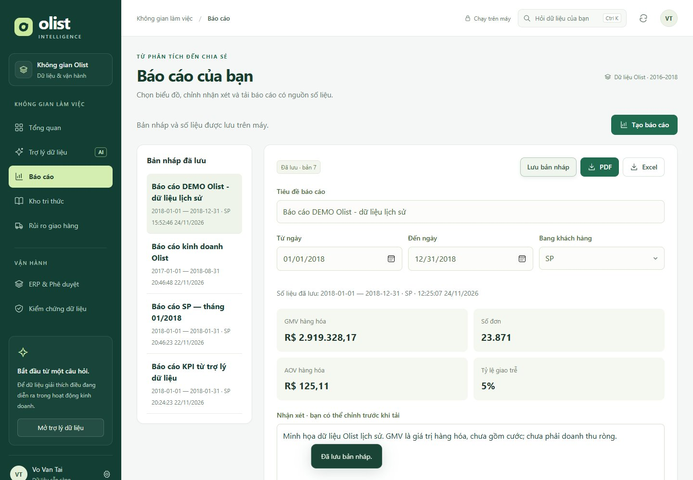

<details>
<summary>Xem file PDF đã xuất</summary>

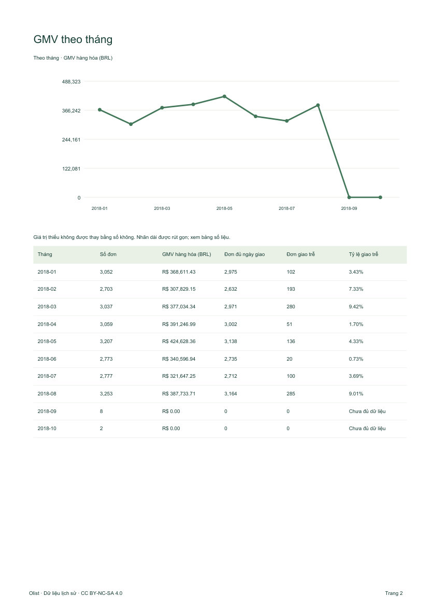

</details>

### 6.4. Kho tri thức

Nhập câu hỏi rồi **Tra cứu**. Xem câu trả lời, mã trích dẫn và các đoạn nguồn. Thử thêm câu ngoài phạm vi để kiểm tra từ chối.

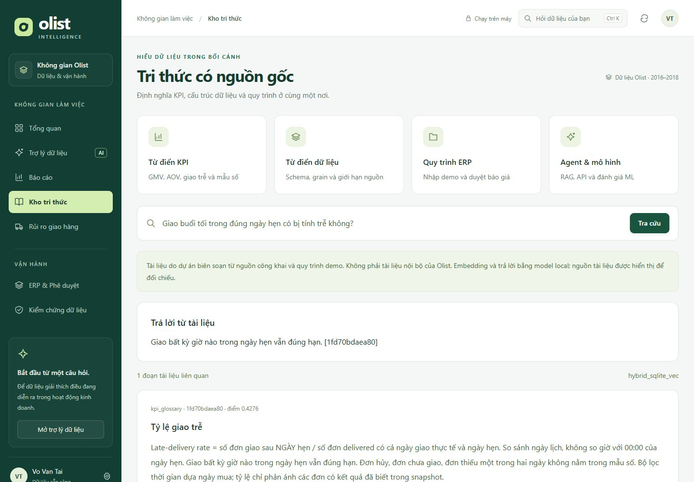

<details>
<summary>Xem từ chối ngoài phạm vi và giao diện điện thoại</summary>

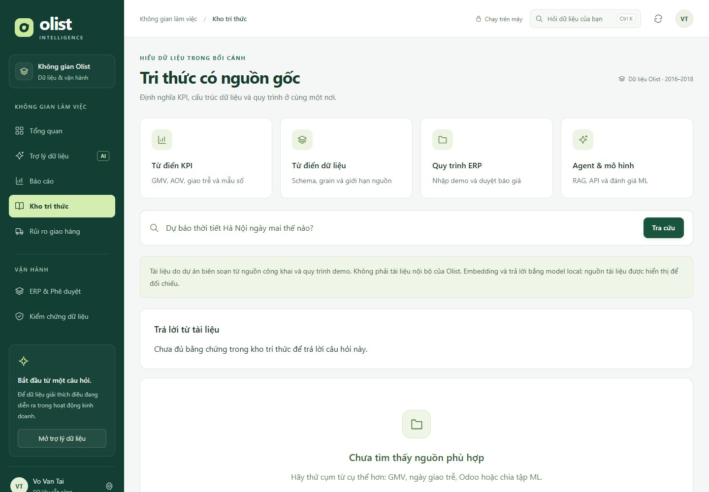
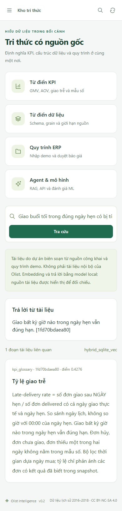

</details>

### 6.5. ML rủi ro giao hàng

Chọn đơn lịch sử, bấm **Tính điểm rủi ro** và đọc cùng bảng holdout. Điểm chưa hiệu chỉnh xác suất; kết quả còn yếu. Không dùng để tự từ chối đơn hoặc kết luận seller gây trễ.

Clone mới chưa có artifact có thể chạy `manage.py train`. Khi phát triển, chọn model/ngưỡng trên validation; không chọn lại theo holdout đã xem. ML giao trễ và fine-tune LLM là hai việc khác nhau; dự án chưa fine-tune LLM.

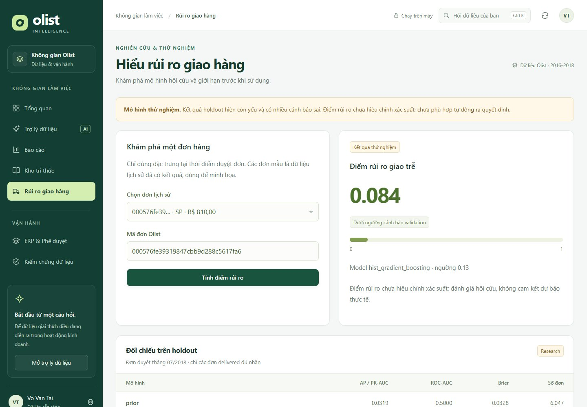

### 6.6. ERP trên web và PDF báo giá

Mở **ERP & Phê duyệt → Đọc lại Odoo**:

1. Tra khách/sản phẩm DEMO theo tên/mã, mở chi tiết.
2. Chọn khách, thêm tối đa 20 dòng, nhập số lượng, đơn giá BRL, giảm và thuế.
3. **Đối soát đề xuất**: Odoo tính thử trong bộ nhớ, chưa tạo báo giá.
4. Đọc tiền trước/sau giảm, thuế, tổng và cách làm tròn.
5. **Lưu đề xuất chờ duyệt**. Người dùng đọc payload, tick và duyệt riêng mới tạo bản nháp.
6. Mở báo giá DEMO đã có, **Tải báo giá PDF** để tải chứng từ hiện tại.

Không tự dùng giá thẻ USD làm BRL. Thuế lấy theo công ty/vị trí tài chính, không đặt mặc định theo tiền tệ. Giá/thuế/khách đổi sau đối soát thì phải đối soát lại.

**Nhờ agent kiểm tra** chuyển bản chụp form sang trợ lý ERP để giải thích. Model không được đổi giá, số lượng hoặc thuế trong bản chụp. Quyền tạo đề xuất trong chat không thay bước duyệt.

Agent hoàn tất trong lượt chụp lại; lượt trước từng chưa hoàn tất dù công cụ Odoo đã trả số. Đây là kết quả từng lần chạy, chưa chứng minh tỷ lệ hoàn thành ổn định.

Duyệt lặp/lấy lại sau lỗi giữ `origin` để tìm và đối chiếu chứng từ. Nếu kẹt `executing`, phải kiểm tra Odoo trước khi khôi phục, không tự phát lại lệnh ghi.

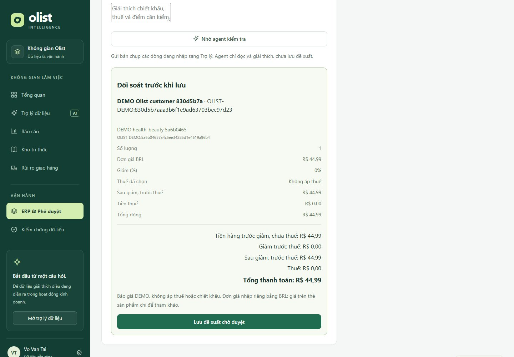

<details>
<summary>Xem PDF từ báo giá DEMO đang có</summary>

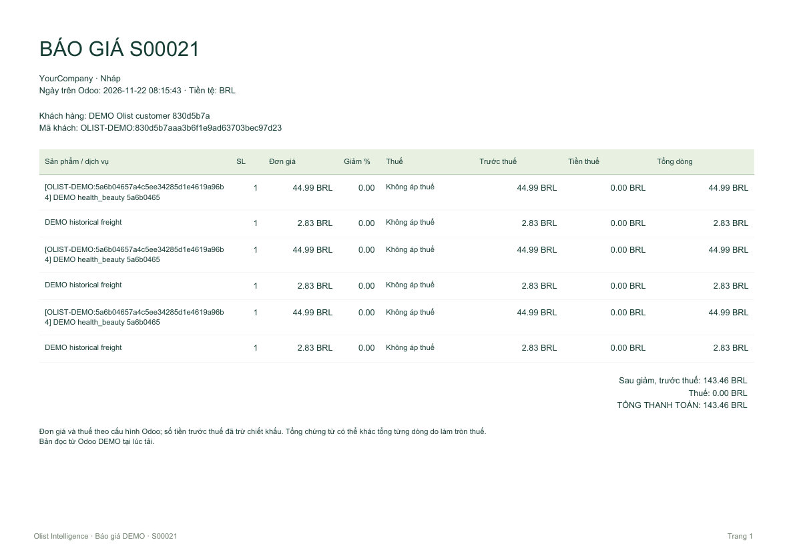
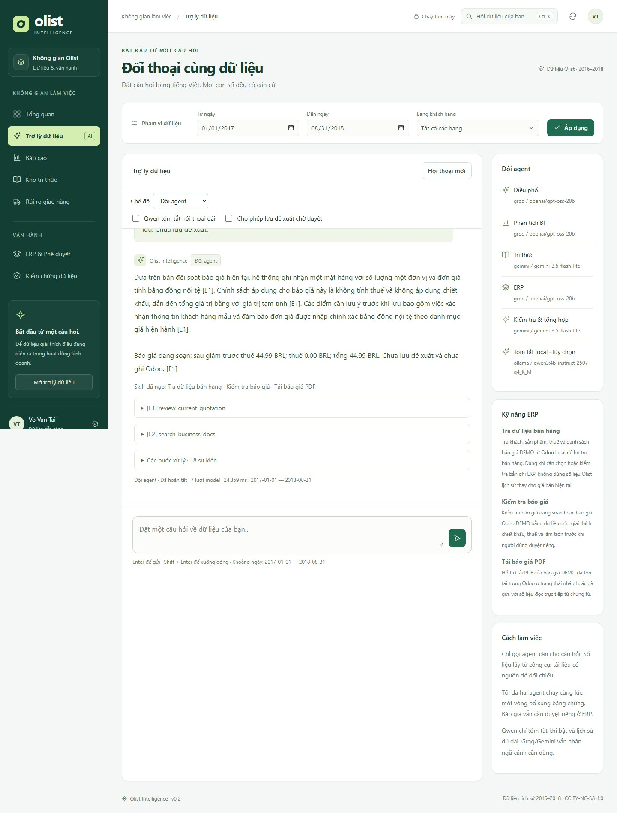

</details>

### 6.7. Chăm sóc khách trong Odoo

Mở app **AI hỗ trợ bán hàng** sẽ vào **Khách cần chăm sóc**, không tự mở cửa sổ ngân sách.

- Ưu tiên: việc quá hạn, hiệu lực báo giá, chưa có việc đang hẹn, rồi các báo giá còn lại.
- Chọn tối đa 20 báo giá DEMO → **Phân tích AI**.
- Groq chọn góc trao đổi, Gemini kiểm tra; nội dung dựng local từ dữ kiện.
- Đọc nguồn, người phụ trách, ngày hẹn và nội dung; chỉ tick/**Duyệt tạo việc** sau khi đối chiếu.
- Nếu AI chưa hợp lệ, giải thích ghi rõ **mẫu quy tắc dự phòng**, không tính là AI thành công.

`no_activity` không chứng minh chưa từng liên hệ/chưa nhận phản hồi. `overdue_activity` không chứng minh việc chưa hoàn tất. Các trạng thái chưa biết không được đổi thành một câu chuyện về khách.

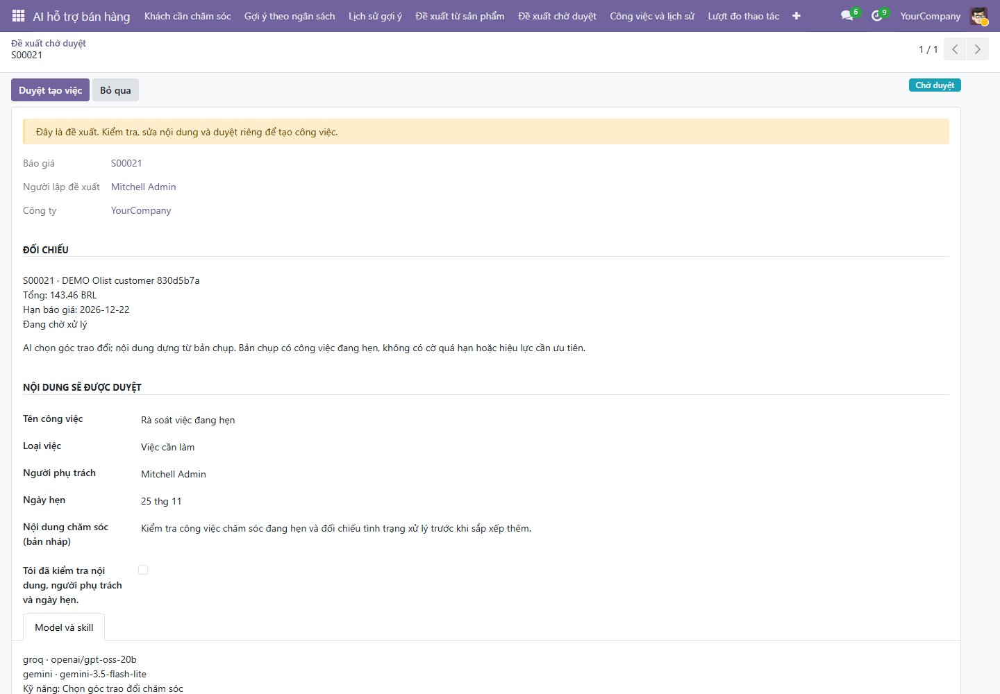

### 6.8. Rủi ro, ghi nhận và so trước/sau

Báo giá DEMO → **Kiểm tra rủi ro**. Odoo tính cờ về hiệu lực, dòng hàng, giá/giảm, thuế và điều khoản; đây chưa phải kiểm tra tín dụng, lợi nhuận hoặc kết luận tuân thủ thuế.

**AI gợi ý câu hỏi đối chiếu** chỉ nhận mã cờ để soạn câu hỏi. Cờ gốc do quy tắc tính, không ghi là AI tự phát hiện.

**Ghi nhận xử lý** có ba lựa chọn: cần sửa, đúng chủ đích, cần quản lý xem; phải kèm lý do. Giữ người ghi, thời điểm và lịch sử. Đúng chủ đích không xóa cờ hoặc thay phê duyệt chứng từ.

Nguồn đổi thì **Kiểm tra lại** để tạo bản mới. Tab **Trước/sau** chia cờ mới/còn xuất hiện/không còn xuất hiện. Bản mới không tự nhận xác nhận của bản cũ.

**Tải báo cáo PDF/Excel** lấy snapshot/lịch sử đã lưu, không gọi thêm model. Excel có ba trang tổng quan/đối chiếu/lịch sử. Nguồn cũ được cảnh báo cả trong giao diện và file.

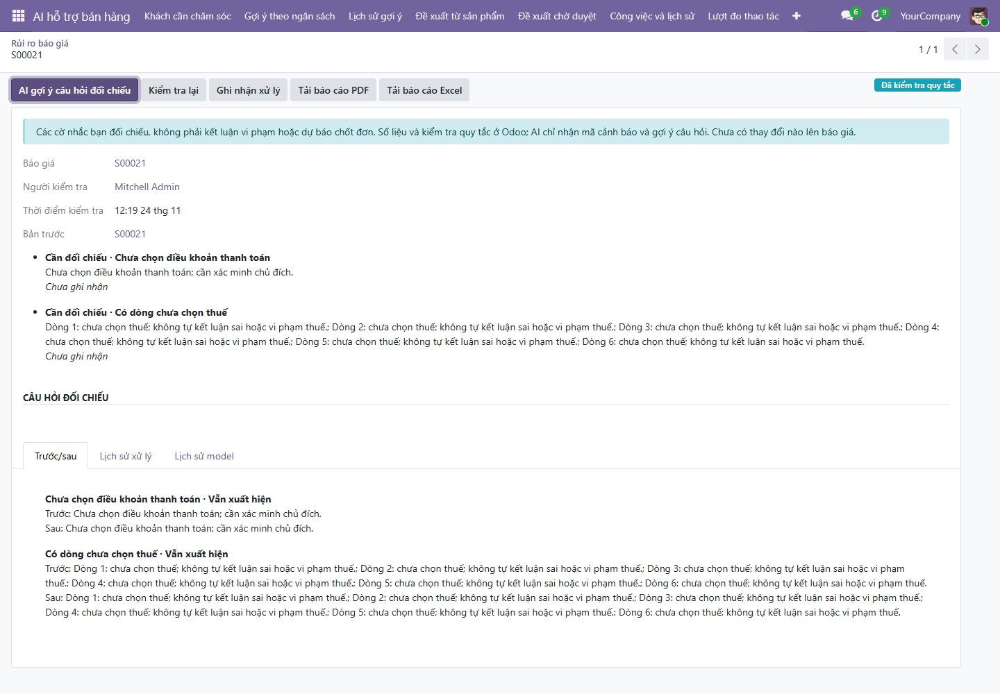

<details>
<summary>Xem đối chiếu, cửa sổ ghi nhận và file xuất</summary>


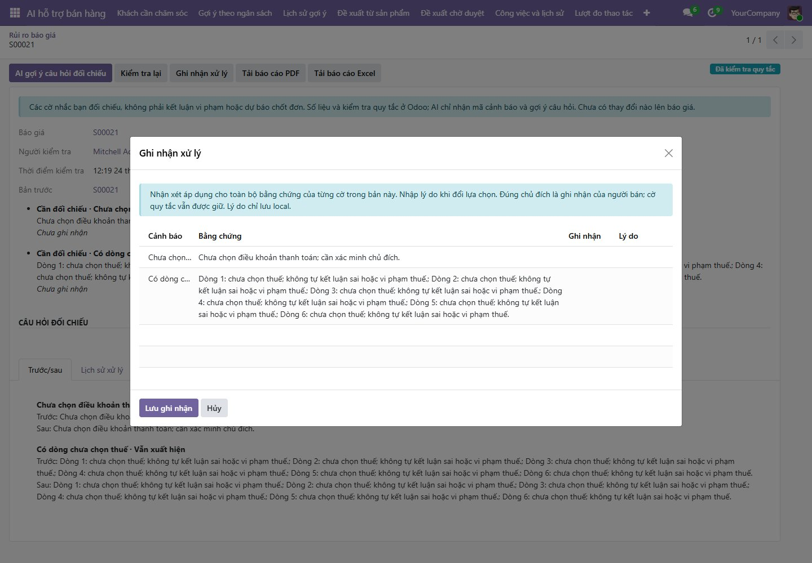
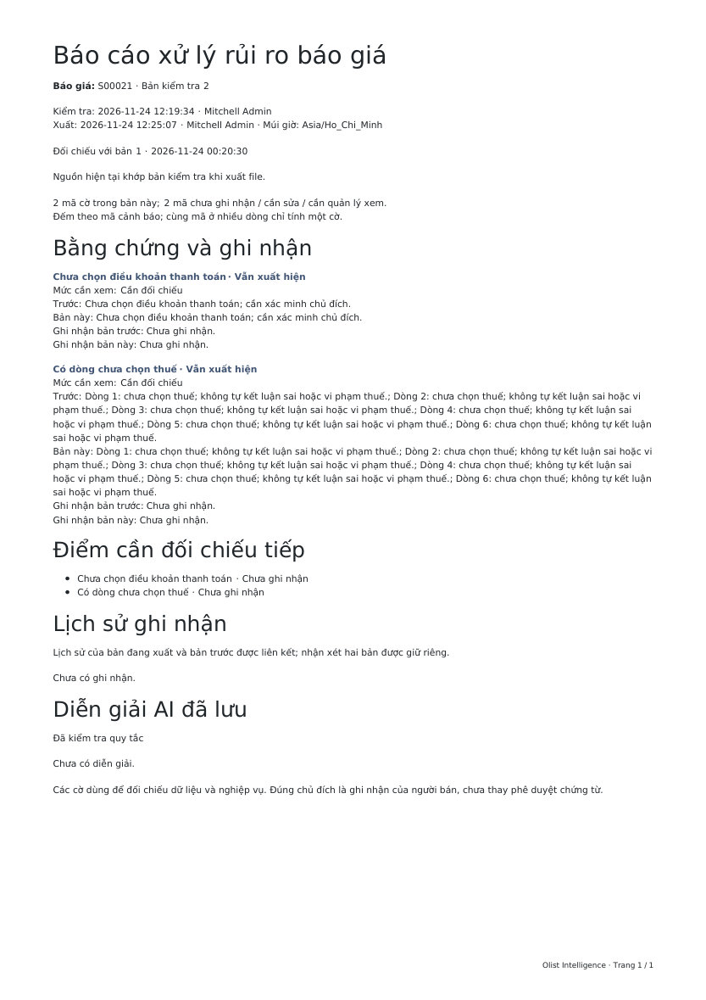
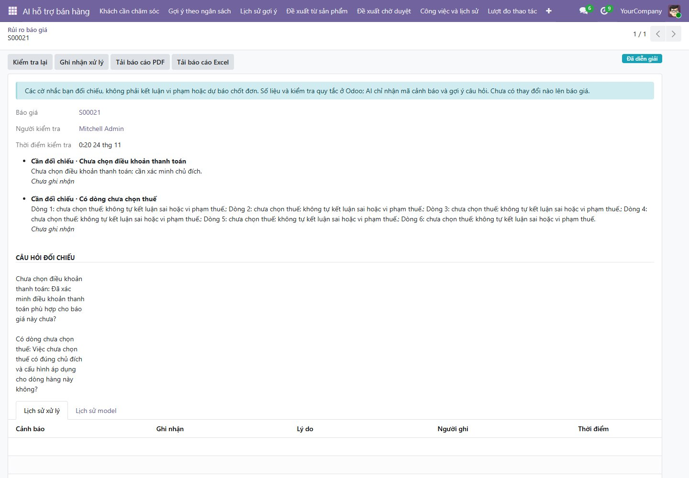

Ảnh diễn giải AI đọc bản đã lưu trước đó và có cảnh báo nguồn cũ; không phải một lượt giải thích mới trên bản hiện tại.

Trong lượt chụp chỉ mở cửa sổ ghi nhận, không lưu kết luận nghiệp vụ thay người dùng. Hành vi lưu/lịch sử/quyền được kiểm tra riêng trong database test.

</details>

### 6.9. Gợi ý sản phẩm theo nhu cầu và ngân sách

Mở **Gợi ý theo ngân sách**, chọn khách DEMO, ví dụ:

```text
Nhu cầu: tìm quà sinh nhật
Nhóm: tự nhận diện
Số lượng mỗi phương án: 1
Ngân sách gồm thuế: 200 BRL
```

Odoo tính tổng theo bảng giá **OLIST DEMO BRL**, vị trí tài chính, thuế và tỷ giá cấu hình, rồi lọc nhóm/ngân sách. Mỗi phương án là lựa chọn thay thế, không phải cộng ba món thành một giỏ.

Xét tối đa 500 sản phẩm DEMO, bỏ cước lịch sử và sản phẩm không phù hợp. Mặc định hiện ba lựa chọn rẻ nhất; AI có thể xếp hạng trong tối đa 12 ứng viên. Không có thông số/tồn kho để khẳng định sản phẩm đáp ứng mọi yêu cầu kỹ thuật.

Tự nhận diện nhóm dùng từ khóa local; nhu cầu mơ hồ thì yêu cầu chọn nhóm. LLM chỉ xếp hạng các mã đã lọc, không đọc nguyên văn nhu cầu để tự tìm sản phẩm ngoài danh mục.

Nhập **R$ 1,00** có thể không có món vừa tiền. Phải nhập điều kiện và bấm **Xem phương án**, không phải mở menu là có sẵn danh sách chọn hàng.

Chọn phương án chỉ mở đề xuất. Đối chiếu nguồn giá, tick và **Duyệt tạo báo giá nháp** riêng. Không xác nhận đơn hoặc lập hóa đơn.

**Lượt minh họa có đầu ra xếp hạng bị bộ kiểm tra từ chối.** Hai phương án Odoo đã lọc vẫn được giữ, trạng thái ghi đúng chưa có xếp hạng AI hợp lệ. Đây không được tính là AI thành công.

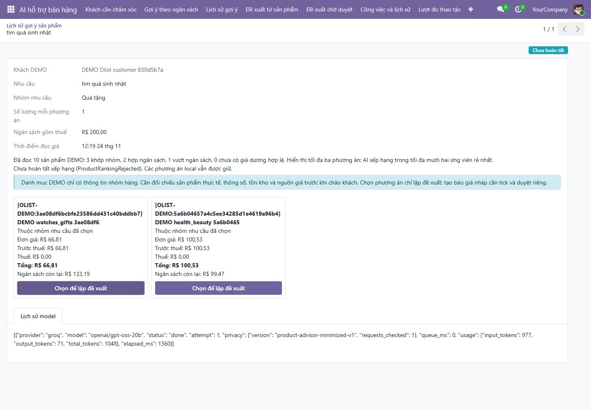

<details>
<summary>Xem bước duyệt riêng</summary>

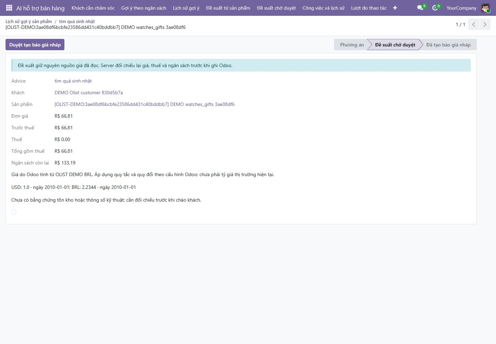

</details>

### 6.10. Kiểm chứng dữ liệu và đo thao tác

**Kiểm chứng dữ liệu** có số dòng, checksum CSV, đối soát tổng tiền và nhật ký. Tổng toàn snapshot không phải KPI delivered của bộ lọc hiện tại.

Trong Odoo, **Bắt đầu lượt đo** luân phiên soạn tay/mẫu/AI. Đồng hồ gồm chờ, đọc, sửa và xác nhận. Kết thúc rồi mới tự chấm. Một người chỉ cho kết quả tự báo cáo thăm dò, không phải đánh giá độc lập.

Giữ cả lượt lỗi, hủy, chưa hoàn tất. Lượt được giao là AI nhưng dùng mẫu thì CSV ghi `rules_fallback`. Không lấy thời gian browser test làm thời gian người dùng.

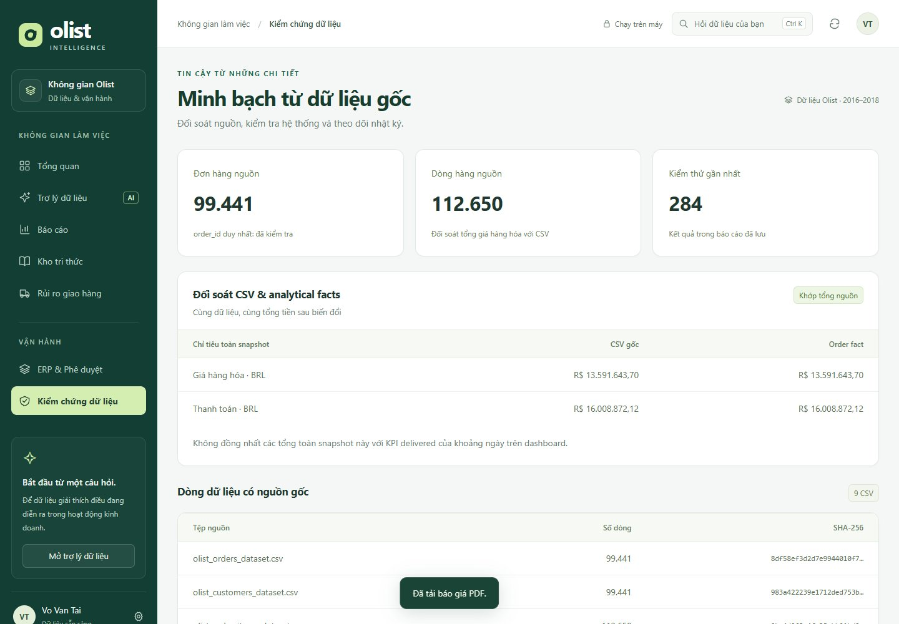

<details>
<summary>Xem các lượt đo đã lưu</summary>

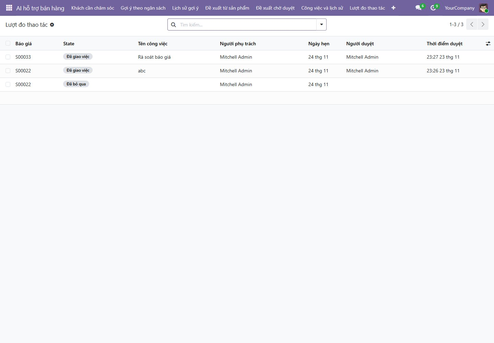

</details>

## 7. RAG hoạt động thế nào

Tri thức công khai nằm trong [olist/knowledge.json](olist/knowledge.json): KPI, schema/giới hạn, ERP DEMO và thiết kế ML/agent. Đây là tài liệu dự án tự biên soạn, không phải tài liệu nội bộ thật của Olist.

1. Chia theo mục; mỗi đoạn tối đa khoảng **1.300 ký tự**, chồng lấp **120 ký tự**.
2. EmbeddingGemma tạo vector local. Index đã đo có **22 đoạn, 768 chiều**.
3. Lưu vector/nguồn trong `data/processed/knowledge.sqlite` bằng `sqlite-vec`.
4. Câu hỏi được nhúng local; tìm cosine và tính TF-IDF có bỏ dấu.
5. Ghép `0,45 × điểm từ khóa + 0,55 × điểm ngữ nghĩa`. Đây không phải xác suất câu trả lời đúng.
6. Giữ nguồn có từ khóa ≥ 0,14 và cosine ≥ 0,40, hoặc cosine ≥ 0,68; chế độ chỉ từ khóa dùng ngưỡng 0,14.
7. Lấy tối đa ba nguồn mặc định, Qwen chọn trích đoạn nguyên văn và mã nguồn.
8. Backend kiểm tra chuỗi/mã; sai, rỗng hoặc lỗi thì từ chối/chỉ cho đối chiếu nguồn.

Index giữ hash corpus và digest model. Thay tài liệu/model phải chạy `manage.py embed`. Lập index dùng file tạm rồi thay một lần; lỗi không xóa index cũ. Thiếu index/model sẽ hiện `lexical_fallback` cùng cảnh báo.

TF-IDF dùng n-gram 3–5 ký tự và bỏ dấu tiếng Việt. Vector embedding được chuẩn hóa trước khi tìm cosine. Chi tiết ở [rag.py](olist/rag.py) và [rag_store.py](olist/rag_store.py).

Tài liệu công ty riêng đặt dạng Markdown trong `data/knowledge/`, ngoài Git; thêm/sửa xong lập lại index. Không đặt tài liệu mật vào JSON công khai hoặc README.

| API có xác thực | Công việc |
|---|---|
| `GET /rag/status` | Kiểm tra index/model còn khớp |
| `POST /rag/search` | Tìm nguồn |
| `POST /rag/answer` | Tìm nguồn và chọn trích đoạn local |

Luồng này chỉ gọi HTTP loopback, không theo redirect/proxy môi trường. Đội agent có ngữ cảnh cloud riêng; không gọi cả ứng dụng là offline. Tham khảo [Ollama embed](https://docs.ollama.com/api/embed) và [sqlite-vec](https://alexgarcia.xyz/sqlite-vec/python.html).

## 8. Tối ưu model nhỏ và API giới hạn

Cách làm chính là giảm phần model phải tự đoán, thay vì chỉ viết prompt dài hơn.

Đầu ra JSON qua Pydantic, chặn trường ngoài schema và kiểm tra mã/lý do/phạm vi theo nguồn. Không cho model tự chạy SQL, shell hoặc cấp quyền ghi. Các request model dùng temperature 0; điều này giảm biến động nhưng không bảo đảm hết lỗi. Xem [transport](olist/team_model.py), [lựa chọn chăm sóc](olist/followup_plans.py) và [xếp hạng sản phẩm](olist/product_advisor.py).

| Cách làm | Tác dụng | Giới hạn |
|---|---|---|
| SQL/công cụ cố định tính KPI | Model không tự tính tiền/viết SQL | Chỉ có metric đã hỗ trợ |
| Odoo tính giá, thuế, làm tròn | Giữ nguồn nghiệp vụ | Cấu hình sai vẫn cần kiểm tra |
| Chọn mã/góc trao đổi hữu hạn | JSON ngắn, ít cơ hội bịa lịch sử | Không phải bài viết tự do |
| Dựng nội dung local | Không cho model tự thêm sự kiện | Người dùng vẫn đối chiếu |
| Dữ kiện tối thiểu | Bớt token và dữ liệu khách ra API | Chưa phải ẩn danh tuyệt đối |
| RAG vài đoạn thay cả tài liệu | Giảm context, có mã nguồn | Liên quan chưa chắc trả lời đủ |
| Index embedding lưu sẵn | Không nhúng lại tài liệu qua cloud | Máy vẫn cần tài nguyên Ollama |
| Chỉ gọi agent cần thiết | Bớt request so với gọi cả đội | Câu ghép vẫn có nhiều bước |
| Tóm tắt lịch sử tùy chọn | Rút context dài | Có thể mất ý; lỗi thì giữ lịch sử |
| run_id/request_id | Lấy lại kết quả sau mất mạng | Lệnh ghi chưa rõ phải đối soát |
| Mẫu/nguồn local khi lỗi | Vẫn có kết quả đúng phạm vi để xem | Không gọi là AI thành công |

Giới hạn đang có trong mã:

- RAG: context Qwen **4.096 token**, đầu ra tối đa **700 token**, trích dẫn phải qua kiểm tra.
- Tóm tắt: chỉ khi bật và lịch sử vượt khoảng **2.500 ký tự**; lấy tối đa **3.000 ký tự cuối**.
- JSON bán hàng: tối đa **4.000 token đầu ra**; Groq GPT-OSS dùng `reasoning_effort=low` khi bật JSON mode. Đây là trần, không phải lượng tiêu thụ cố định.
- Chăm sóc assisted có deadline **85 giây**; các luồng khác có giới hạn riêng.
- Hàng chờ bán hàng mặc định cách ít nhất **12 giây** giữa hai lần bắt đầu cùng model trong tiến trình, tối đa **2 lần gửi/bước**.
- Riêng transport bán hàng chỉ retry HTTP tạm thời 429/502/503/504, tôn trọng `Retry-After` và dừng nếu chờ quá hạn. Không lặp nội dung sai để chọn kết quả đẹp.

Chỉ cần KPI thì dùng Trợ lý thường. Chỉ cần quy tắc thì `rules_only`. Bật nhiều agent khi thật sự cần ghép công cụ/nguồn. Chưa có bằng chứng rằng hai model luôn rẻ hoặc tốt hơn một.

Chưa có LoRA/QLoRA hoặc tối ưu weights LLM. Đây là tối ưu cách giao việc, context, công cụ và xử lý lỗi lúc inference.


## 9. Vấn đề đã gặp và cách giải quyết

| Vấn đề | Cách xử lý | Điều cần giữ rõ |
|---|---|---|
| Join item/payment làm nhân tiền | Aggregate riêng về order_id trước khi join | Đối soát CSV độc lập |
| So giờ khiến giao trong ngày hẹn bị tính trễ | So ngày lịch, chỉ lấy đơn đủ ngày | Test biên ngày |
| LLM viết lịch sử khách không có trong nguồn | Lựa chọn hữu hạn và dựng câu local | Giữ baseline văn bản cũ để so |
| Reviewer chấm nhầm lựa chọn như bài viết | Skill lựa chọn riêng, khóa `selection` | Không coi cấu trúc đúng là chất lượng nghiệp vụ |
| API 429/503 | Hàng chờ, retry có hạn, trace, kết quả dự phòng | Không bảo đảm dịch vụ luôn sẵn sàng |
| Giá thẻ USD bị dùng nhầm làm BRL | Tách giá thẻ/báo giá, để Odoo tính | Không gọi giá DEMO là giá thị trường |
| Timeout rồi duyệt lại có thể trùng | Giữ request/origin, đọc đối chiếu | Không tự phát lại executing |
| RAG còn dùng tài liệu cũ | Hash corpus/model, báo index không khớp | Lập lại sau đổi nguồn |
| Trích dẫn bị model viết lại | Chặn đầu ra, chỉ cho đọc nguồn | Có một ca đã rơi vào nhánh này |
| Ngân sách thấp không có sản phẩm | Hiện số khớp/vượt ngân sách | Không tự thêm hàng giả |
| Nhiều hướng dẫn cũ gây lẫn bản | Gom README, corpus RAG chuyển JSON | Giữ SKILL.md phục vụ chương trình |

## 10. Phạm vi dữ liệu và bảo mật

| Luồng | Ra model | Giữ local |
|---|---|---|
| RAG local | Câu hỏi/nguồn đến Ollama loopback | Không gửi tài liệu riêng ra cloud qua luồng này |
| Chăm sóc Odoo | Mã tạm, trạng thái, cờ, action/focus được phép | Tên/ID thật, giá, ngày cụ thể, ghi chú |
| Rủi ro báo giá | Mã tạm, cờ, câu hỏi đã lọc cho reviewer | Snapshot, tên, giá, lý do xử lý |
| Xếp hạng sản phẩm | Mã tạm, nhóm hàng, mức ngân sách tương đối | Nhu cầu nguyên văn, tên/ID thật, số lượng, giá/thuế/ngân sách cụ thể |
| Chat/Đội agent | Câu hỏi, lịch sử và dữ liệu công cụ trong context | Không tự coi là cùng phạm vi bảo vệ với addon tối thiểu |

Allowlist được kiểm tra ở body HTTP thật của cả hai model trong các luồng tối thiểu. Test dùng canary tên/email/giá. Backend bỏ payload tạm khi job kết thúc; Odoo vẫn giữ snapshot/audit local.

`.env`, CSV gốc, database, model, cache và tài liệu riêng không lên Git. Ảnh ở `media/demo/` là phần minh họa được chọn từ Olist công khai/Odoo DEMO, không phải dữ liệu khách doanh nghiệp.

Web dùng cookie HttpOnly/SameSite Strict hoặc token, kiểm tra same-origin cho thao tác ghi. Addon có quyền người lập/quản lý nhóm/công ty. FastAPI local chưa có đăng nhập nhiều người, RBAC tài liệu theo phòng ban hoặc kiểm thử tải doanh nghiệp. Không mở cổng app ra Internet.

Lọc dữ liệu ở ứng dụng không thay billing, logging hoặc ZDR của nhà cung cấp. Trước khi dùng dữ liệu khách thật, phải rà đúng từng luồng và cấu hình dịch vụ.

## 11. Kết quả đo

### 11.1. Chăm sóc khách

Lượt phát triển ngày 24/11/2026: **10 họ, một biến thể/họ, một lần lặp**, nhãn kỹ thuật do dự án biên soạn.

| Phương án | AI được chấp nhận | Mẫu dự phòng | Có kết quả để xem |
|---|---:|---:|---:|
| Pipeline văn bản cũ | 3/10 | 0/10 | 3/10 |
| Lựa chọn hữu hạn, lượt đầu | 7/10 | 3/10 | 10/10 |
| Sau tách skill reviewer | 10/10 | 0/10 | 10/10 |
| Quy tắc, lượt cuối | Không gọi model | Không áp dụng | 10/10 |

Lượt cuối: assisted trung vị **11,93 giây**, quy tắc **15,5 mili giây**. Hai mươi request model qua allowlist HTTP. Chưa xác minh đơn giá cho lượt này nên chi phí để trống.

Hai tình huống dev tái hiện reviewer nhầm quy tắc viết văn bản/loại việc/cờ hiệu lực; tình huống bị từ chối còn lại được chấp nhận khi chạy lại. Bản sửa dùng skill riêng và `selection`.

Luồng mới chọn mã rồi dựng câu local, luồng cũ viết tự do: đây không phải so hai bài viết cùng độ khó. Không suy ra AI viết tốt hơn người bán, tăng tỷ lệ chốt hoặc tiết kiệm thời gian thao tác. Một lần chạy không bảo đảm API luôn thành công.

Fixture có 30 họ × 4 biến thể riêng tư = 120 mẫu, không phải 120 tình huống độc lập. Chia 10 họ dev và 20 họ dự phòng. Không chỉnh trên tập dự phòng rồi gọi đó là kiểm chứng độc lập. Pilot chỉ có một người, vẫn giữ lượt AI thất bại và các nhận xét đã có.

### 11.2. RAG

Tập kiểm tra nhỏ có 8 câu có nguồn, 4 câu ngoài phạm vi:

| Cách tra | Đúng nguồn đầu tiên | Từ chối ngoài phạm vi |
|---|---:|---:|
| TF-IDF | 8/8 | 1/4 |
| Hybrid local | 8/8 | 4/4 |

Qwen có trích dẫn được chấp nhận ở **7/8 câu có nguồn**; một đầu ra chuyển sang đối chiếu nguồn. Cả bốn câu ngoài phạm vi bị từ chối trước sinh nội dung. Sau chuyển corpus khỏi docs, đã chạy lại truy xuất và giữ kết quả 8/8, 4/4.

Corpus/nhãn do dự án biên soạn. Đúng nguyên văn chứng minh xuất xứ, chưa chứng minh trả lời đủ. Chạy lại bộ đã dùng là regression, không phải holdout mới.

### 11.3. ML giao trễ

Chọn trên validation: `HistGradientBoosting`. Holdout tháng 07/2018 có 6.047 đơn đủ nhãn:

| Chỉ số | Kết quả |
|---|---:|
| AP / PR-AUC | 0,04995 |
| ROC-AUC | 0,60215 |
| Precision tại ngưỡng 0,13 | 4,56% |
| Recall | 45,08% |
| Brier | 0,04151 |

Brier kém baseline, chưa hiệu chỉnh xác suất, không tự quyết định nghiệp vụ. Không chọn lại model/ngưỡng theo holdout. Snapshot không chứng minh thuộc tính chưa từng bị sửa sau thời điểm dự đoán.

### 11.4. Bằng chứng phần mềm

- **284 test backend**, **42 test addon** tại mốc chuẩn bị README; xem kết quả và phạm vi của CI/lượt phát hành tương ứng.
- [verification.json](reports/verification.json): đối soát CSV độc lập và kiểm tra HTTP.
- [ai_delivery_20261124.json](reports/ai_delivery_20261124.json): commit/hash/model/mẫu số của lượt đo trước khi gom tài liệu.
- [demo_evidence.json](reports/demo_evidence.json): ảnh, file tải, trạng thái và giới hạn lần chụp.
- [ml_evaluation.json](reports/ml_evaluation.json): split, baseline, ngưỡng và giới hạn ML.

Đường dẫn/hash trong báo cáo cũ thuộc commit được ghi trong báo cáo. Không viết lại lịch sử hoặc xóa kết quả chưa tốt khi dọn tài liệu. Test cấu trúc/quyền không thay đánh giá nội dung độc lập.

## 12. Kịch bản trình diễn và tái lập bằng chứng

Có thể trình bày khoảng 8–10 phút, tùy thời gian chờ API:

| Bước | Thao tác | Điều cần chứng minh |
|---|---|---|
| 1 | Lọc 2018, SP; tải CSV | Cùng nguồn/phạm vi và định nghĩa KPI |
| 2 | Trợ lý thường hỏi KPI; Đội agent hỏi KPI + AOV | Công cụ BI và tài liệu có nguồn |
| 3 | Chỉnh báo cáo/biểu đồ; tải PDF/Excel | Tải file thật, không chỉ chụp form |
| 4 | RAG hỏi ngày giao hẹn, rồi thời tiết | Có nguồn và biết từ chối |
| 5 | ML chọn đơn lịch sử | Hiểu điểm yếu và holdout |
| 6 | ERP tra cứu, đối soát, tải PDF đã có | Odoo tính số; chưa duyệt chưa ghi báo giá mới |
| 7 | Odoo xem chăm sóc/lượt đo/rủi ro/trước-sau | Có nguồn, lịch sử và bước kiểm tra |
| 8 | Quà sinh nhật, 200 BRL; mở đề xuất | Lọc ngân sách, chặn AI sai, duyệt riêng |

Ảnh chụp tự động trên app thật, không phải người dùng độc lập đánh giá. Trong lượt chụp, cửa sổ ghi nhận chỉ mở để xem, không lưu kết luận nghiệp vụ. Các bảng báo giá, khách, hóa đơn và hoạt động được đối chiếu trước/sau để kiểm tra không có phê duyệt ngoài ý muốn.

Một số ảnh đọc bản DEMO đã có. Trạng thái AI không hợp lệ được giữ, không đổi chữ giả thành thành công. Hành vi phê duyệt có ghi ERP được kiểm tra trong database test; fixture không đưa vào database đang dùng.

Tái lập khi app/Odoo chạy và có bản ghi DEMO phù hợp:

```powershell
.\.venv\Scripts\python.exe -m pip install playwright pypdf openpyxl
.\.venv\Scripts\python.exe tests/browser_readme_demo.py --phase web
.\.venv\Scripts\python.exe tests/browser_readme_demo.py --phase team
.\.venv\Scripts\python.exe tests/browser_readme_demo.py --phase erp
.\.venv\Scripts\python.exe tests/browser_readme_demo.py --phase odoo
```

Script dùng Edge trên Windows và bản DEMO của lần chuẩn bị này, không phải bộ seed thay Olist. Xem `--help` để dùng lại review/advice đã tạo khi chụp lại. File gốc/PDF/Excel/CSV nằm ngoài Git ở `.openai/qa/readme-demo/`; chỉ ảnh được chọn mới vào `media/demo/`.

Để render trang PDF thành ảnh có thể dùng PyMuPDF. Đây là công cụ tạo bằng chứng tùy chọn, không cần cho người dùng chạy app.

## 13. Kiểm thử, cập nhật và xử lý lỗi

### 13.1. Kiểm thử

```powershell
.\.venv\Scripts\python.exe -m pip install -r requirements-dev.txt -r requirements-agent.txt
.\.venv\Scripts\python.exe -m pytest -q
node --check frontend/assets/app.js
node --check frontend/assets/reports.js
node --check frontend/assets/sales.js
.\.venv\Scripts\python.exe scripts/verify_release.py
.\.venv\Scripts\python.exe scripts/test_odoo_ai.py
git diff --check
```

`verify_release.py` cần dữ liệu đã setup, kiểm tra offline trong server tạm. `test_odoo_ai.py` cần Docker/Odoo, tự tạo/xóa database test, không dùng database chính. Không cần train lại ML khi đổi README/giao diện.

### 13.2. Đo khi thay model/prompt/skill

```powershell
.\.venv\Scripts\python.exe scripts/benchmark_rag.py --split dev --answers --out data/processed/rag-dev-new.json
.\.venv\Scripts\python.exe scripts/benchmark_followup.py run --strategies rules --limit 10
.\.venv\Scripts\python.exe scripts/benchmark_followup.py run --live --strategies rules,assisted --limit 10 --max-attempts 2 --request-interval 12 --max-model-calls 40
```

`--live` gọi API thật. Script kiểm tra ngân sách request tối đa trước khi chạy, giữ lỗi trong mẫu số, không ghi đè kết quả đã có.

Thay model/prompt/skill: đo phần bị ảnh hưởng trên cùng bộ dev/baseline và lưu phiên bản. Thay trường dữ liệu gửi model: chạy lại test HTTP riêng tư. Thêm quyền ghi: kiểm tra phê duyệt, nguồn cũ, quyền và ghi lặp. Thêm một tính năng không đồng nghĩa phải làm lại mọi chứng minh từ đầu.

Chấm nội dung cần phiếu mù/người chấm. So các phiên bản chỉ khi cùng tập, ca, số lặp và chính sách phù hợp. Không tự điền điểm chất lượng người dùng bằng kết quả test.

### 13.3. Cập nhật

Working tree sạch thì `git pull --ff-only`. Giữ `.env`, dữ liệu, model và Docker volumes. Đổi schema addon cần sao lưu database và nâng cấp module trong Odoo; restart container không tự nâng cấp schema.

### 13.4. Lỗi thường gặp

| Hiện tượng | Cách xử lý |
|---|---|
| Thiếu uvicorn/httpx | Dùng đúng `.venv\Scripts\python.exe` để pip/chạy, không dùng Code Runner/Python global |
| Pip timeout | Chạy lại SETUP, giữ .venv/cache; script có timeout/retry |
| Tiếng Việt cp1258 | Launcher hoặc `python -X utf8`; đặt `PYTHONUTF8=1` khi cần |
| Cổng 8000 đã dùng | Mở web hiện có, nhận diện đúng tiến trình dự án rồi dừng đúng PID |
| Không kết nối web | Kiểm tra launcher, /health, token và phiên; không đăng token lên Git |
| Odoo không lên | Docker Desktop, compose ps và log dịch vụ |
| Odoo AI 401/không lấy kết quả | Bridge token, backend 8000, môi trường container sau đổi .env |
| Không thấy addon | Apps list, mount odoo_addons, tên module |
| API 400/401/403/404 | Kiểm tra model ID/quyền/key, không retry như lỗi tạm thời |
| API 429/503 | Xem quota/dịch vụ, tôn trọng Retry-After, dùng local/quy tắc |
| RAG lexical_fallback | Kiểm tra Ollama, tên model, nguồn/digest và lập lại index |
| Không có sản phẩm | Kiểm tra nhóm/số lượng/ngân sách BRL/danh mục; không thêm hàng giả |
| Tổng thay đổi lúc duyệt | Lập đối soát mới, không ép ghi snapshot cũ |
| PDF thiếu font | Cài dependencies; Windows dùng Arial, Linux dùng font được hỗ trợ |
| ML thiếu artifact/khác sklearn | Tái tạo theo quy trình nghiên cứu, không chỉnh để làm đẹp holdout |

Nhận diện cổng:

```powershell
Get-NetTCPConnection -LocalPort 8000 -State Listen |
  Select-Object LocalAddress, OwningProcess
```

Tra `Win32_Process` bằng PID thực tế để xem executable/command line. Chỉ dừng đúng tiến trình đã xác định của dự án; không tắt toàn bộ `python.exe`.

## 14. Mã nguồn, dữ liệu và giấy phép

```text
frontend/             HTML/CSS/JavaScript, không cần build
olist/                FastAPI, BI, RAG, agent, model transport, xuất file
olist/knowledge.json   Tri thức công khai của RAG
.agents/skills/        SKILL.md đang được các luồng AI đọc
odoo_addons/           Module bán hàng và test native Odoo
scripts/              Setup, seed DEMO, benchmark, kiểm tra
tests/                Unit/integration/browser
reports/              Bằng chứng và kết quả có phiên bản
media/demo/           Ảnh minh họa cho README
data/                 CSV/database/tài liệu riêng, không commit
models/               Artifact ML local, không commit
README.md             Hướng dẫn và báo cáo chính
```

SKILL.md là tài nguyên chương trình, không phải hướng dẫn cài đặt lặp lại. Có skill tra bán hàng, đối soát/PDF, chăm sóc/kiểm tra bản nháp, lựa chọn chăm sóc, rủi ro và xếp hạng. Quyền công cụ nằm trong code; sửa skill không tự cấp quyền ghi ERP.

Đã dọn bản Streamlit cũ, manifest gói vá và Markdown hướng dẫn rời. Công cụ preview phát triển vẫn giữ, người dùng không cần Node để chạy app.

### Nguồn và điều kiện dữ liệu

Nguồn: **Brazilian E-Commerce Public Dataset by Olist**, Olist và các cộng tác viên ghi trên [Kaggle](https://www.kaggle.com/datasets/olistbr/brazilian-ecommerce), giai đoạn 2016–2018. Snapshot đối soát có **99.441 đơn, 112.650 item**; số dòng/hash thực tế ở [data_quality.json](reports/data_quality.json).

Dataset được ghi giấy phép **CC BY-NC-SA 4.0**; [nội dung giấy phép](https://creativecommons.org/licenses/by-nc-sa/4.0/). CSV tải riêng, không đóng kèm Git. Dự án aggregate item/payment/review, chuẩn hóa ngày, thêm nhãn trễ theo ngày lịch và chuyển đối tượng ERP DEMO. Các thay đổi do dự án thực hiện, không phải Olist xác nhận.

Không có giá vốn, tồn kho, thông số sản phẩm hoặc nghiệp vụ nhà máy. Không suy ra lợi nhuận, tồn kho hoặc sản xuất từ nguồn này. Odoo DEMO không phải ERP gốc của Olist.

Mã nguồn có MIT trong [LICENSE](LICENSE); giấy phép mã không thay giấy phép dataset. Artifact thử nghiệm/phần báo cáo dẫn xuất giữ CC BY-NC-SA 4.0 trong phạm vi áp dụng. Thông báo này không khẳng định model chính xác hoặc giải quyết mọi vấn đề pháp lý của artifact dẫn xuất.

Fixture tổng hợp chỉ nằm trong tests/database test và ghi rõ; không thay nguồn Olist thật trong ứng dụng.
