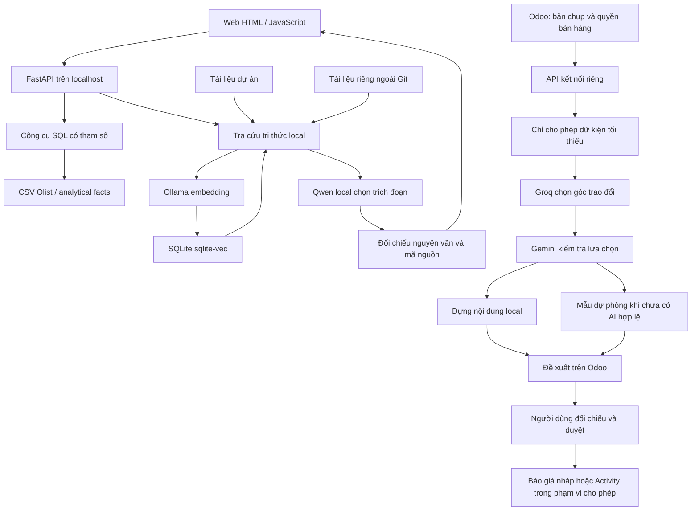

# Bản demo AI tích hợp ERP

Đây là bản thử nghiệm chạy local cho bài toán hỗ trợ bán hàng và tra cứu tri thức. Dữ liệu BI là Olist công khai, đối tượng ERP là DEMO. Chưa triển khai cho doanh nghiệp, chưa chứng minh tăng doanh thu và chưa fine-tune LLM.

## Kiến trúc

Agent cloud chỉ được tra tài liệu công khai của dự án. Các file Markdown riêng trong `data/knowledge/` chỉ đi qua RAG local; thư mục và index không lên Git. Luồng chăm sóc gửi mã tạm, cờ quy tắc và lựa chọn hữu hạn, giữ tên khách, giá, ngày cụ thể và ghi chú tại máy. Đây là phạm vi bảo vệ của các luồng đã mô tả, không phải chứng nhận bảo mật toàn bộ hệ thống.

## Các quyết định kỹ thuật

- KPI lấy từ công cụ truy vấn; model không được tự viết SQL hoặc sửa số.
- RAG ghép điểm từ khóa và cosine, kiểm tra dấu vân tay tài liệu/model. Không đủ nguồn thì từ chối; lỗi model thì cho đối chiếu nguồn và thông báo rõ.
- Qwen chọn trích đoạn; backend chỉ chấp nhận chuỗi có nguyên văn trong nguồn. Cách này giữ xuất xứ nhưng chưa bảo đảm đoạn trích trả lời đầy đủ mọi câu hỏi.
- AI chăm sóc chọn góc trao đổi trong danh sách đã giới hạn. Trạng thái và cờ do Odoo/quy tắc xác định; nội dung cuối dựng local, không tính là model tự suy luận ra các cờ hoặc tự viết toàn bộ nội dung.
- Reviewer kiểm tra lựa chọn theo đúng hợp đồng đầu ra, không áp quy tắc chấm văn bản cho một bản lựa chọn chưa có văn bản. Luồng văn bản cũ vẫn giữ làm baseline thử nghiệm.
- API/model lỗi hoặc reviewer từ chối thì trả mẫu dự phòng có nhãn riêng. Tỷ lệ trả được kết quả của ứng dụng và tỷ lệ AI được chấp nhận được đo riêng.
- Ghi ERP cần đề xuất và duyệt riêng. Không tự xác nhận đơn, tạo hóa đơn, xuất kho hoặc liên hệ khách.

## Chạy demo

1. Chạy Docker Desktop và Odoo theo `docs/ODOO_WINDOWS.md`; mở ứng dụng bằng `START_WINDOWS.bat`.
2. Chuẩn bị embedding/index theo [RAG local](RAG_LOCAL.md). Kiểm tra `/rag/status` qua phiên đã xác thực.
3. Mở **Kho tri thức**, hỏi “Giao buổi tối trong đúng ngày hẹn có bị tính trễ không?”. Đối chiếu câu trả lời, mã đoạn và phần nguồn.
4. Hỏi một câu ngoài phạm vi như dự báo thời tiết; xem thông báo chưa đủ bằng chứng.
5. Trong Odoo, mở **AI hỗ trợ bán hàng**. Tạo đề xuất chăm sóc từ một báo giá DEMO; xem nội dung, nguồn và lịch sử model. Dừng trước nút duyệt nếu chỉ trình diễn.
6. Mở **Lịch sử gợi ý**, xem phương án sản phẩm theo ngân sách; đối chiếu tổng tiền Odoo và bước duyệt tạo báo giá nháp.

Script `python tests/browser_ai_demo.py --record` kiểm tra RAG desktop/mobile và đọc lượt gợi ý ngân sách đã có trong Odoo. Script này cần Playwright, Edge, `python -m playwright install ffmpeg` và một lượt gợi ý BRL 200 có hai phương án. Đây là QA tự động trên dữ liệu hiện có, không phải người dùng thực hiện pilot. Video MP4 bàn giao nằm tại `.openai/exports/ai-demo/demo-ai-local.mp4`, giữ ngoài Git cùng ảnh và kết quả browser.

## Bằng chứng và giới hạn

Xem [đánh giá AI](AI_EVALUATION.md), [báo cáo bàn giao](../reports/ai_delivery_20261124.json) và [cách tái lập RAG](RAG_LOCAL.md). Báo cáo ghi phiên bản mã nguồn, mẫu số, kết quả lỗi/dự phòng và thời gian; các lượt cũ được giữ.

Bộ đánh giá nhỏ, nhãn do dự án biên soạn, chưa có chuyên gia chấm độc lập. Điểm kỹ thuật không chứng minh tiết kiệm thời gian người dùng hoặc tăng tỷ lệ chốt. Tập dự phòng của chăm sóc và holdout ML giao trễ không được dùng để chỉnh lần phát triển này. Model ML giao trễ vẫn có giới hạn đã công bố trong README.

Bản local chưa có đăng nhập nhiều người cho web FastAPI, phân quyền tài liệu theo phòng ban, thử tải nhiều người hoặc vận hành Internet. Quyền nhân viên/quản lý trong addon Odoo không thay thế những phần đó. Chưa xây mobile riêng; mới kiểm tra giao diện responsive. Đây là các giới hạn để trình bày rõ khi ứng tuyển, không phải chức năng đã hoàn thành.
